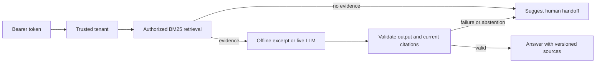

# Evidence-backed support assistant

[](https://github.com/din-tezekbayev/python-ai-support-tools/actions/workflows/tests.yml)

**A runnable Python example of turning company policies into traceable support answers.** It retrieves the authenticated customer's approved knowledge, returns source citations, and suggests a human handoff when evidence is missing or fails validation.

Built with **LangGraph · FastAPI · Pydantic · SQLite · BM25 retrieval**, with an optional live LLM adapter, behavioral tests and a repeatable retrieval evaluation. The default mode runs locally without API keys or model calls.

**Portfolio demonstration, October 2026, built with AI assistance.** All documents and businesses here are invented. This is new demonstration code, separate from historical commercial work; it contains no client source code or customer data.

## The business problem

Support staff repeatedly look up booking, cancellation and payment policies. A useful assistant must identify which company's policy applies, avoid quoting withdrawn guidance, and leave unsupported requests to a person. This project makes that workflow inspectable from API input to evidence and failure handling.

For example, a clinic customer asks how to book an appointment. The service authenticates the caller, searches only that tenant's approved customer-facing documents, and returns an excerpt with a versioned citation. A question with no matching evidence receives `needs_human`. If a source is withdrawn during generation, final citation validation rejects it.

The intended benefit is less repetitive policy lookup and easier review of an answer's sources. **No commercial savings, adoption or production accuracy are claimed.** [Why these capabilities matter for relevant engineering roles](docs/role-fit.md).

## Try it in two minutes

Python 3.10+ and [uv](https://docs.astral.sh/uv/getting-started/installation/):

```bash
git clone https://github.com/din-tezekbayev/python-ai-support-tools.git
cd python-ai-support-tools
uv sync --frozen
uv run --frozen python rag_demo.py
uv run --frozen python -m unittest discover -s tests -v
uv run --frozen python -m evals.run --check
```

`uv.lock` fixes resolved dependencies. The CLI prints the answer mode, sources, workflow steps and elapsed time. The older, dependency-free tool boundary example still runs with `python3 demo.py`.

## What is implemented

| Capability | Behavior to inspect |
|---|---|
| Knowledge ingestion | Bounded word chunks, source versions, exact replay, replacement of superseded chunks and source revocation. |
| Retrieval | BM25 over **only** the trusted tenant's approved, customer-facing, active chunks; access filtering precedes ranking and corpus statistics. |
| Orchestration | A real LangGraph `StateGraph` with retrieval, generation, validation and abstention branches; bounded steps and no autonomous tool loop. |
| Evidence | Citations identify source, version and chunk. They must come from this request's retrieval and still match current authorized content before returning. |
| Answer modes | Offline exact excerpts for repeatability; opt-in OpenAI-compatible Chat Completions adapter for live generation. |
| API | FastAPI/Pydantic request validation, bounded body/question, server-side bearer-token → tenant mapping and per-request state. |
| Failure handling | Missing evidence, provider failure, invalid citations or withdrawn evidence produce a human-handoff suggestion. No actual message or ticket is sent by the RAG workflow. |
| Observability | Request ID, total latency, status and graph steps in responses and structured Python log fields; no external tracing service required. |
| Tool boundary | Separate original example validates proposed tool arguments and permissions and uses tenant-scoped idempotency keys for SQLite tickets. |
| Verification | Behavioral tests plus fixed retrieval cases, CI on Python 3.10 and 3.14, and a failing evaluation gate for fixture regressions. |

## How the request moves



Ingestion is an operator-side Python interface, separate from the public question endpoint. Neither a request body nor a model response chooses the tenant. Retrieved text has no authority to execute an action. The RAG workflow and the original ticket example are deliberately separate: there is no automatic helpdesk integration.

## Run the HTTP service

Seed a fresh synthetic database, generate a local test credential and start the service on loopback:

```bash
uv run --frozen python rag_demo.py --database support-demo.sqlite3
export SUPPORT_DEMO_TOKEN="$(python3 -c 'import secrets; print(secrets.token_urlsafe(32))')"
export SUPPORT_API_TOKENS="$(python3 -c 'import json, os; print(json.dumps({os.environ["SUPPORT_DEMO_TOKEN"]: "clinic-a"}))')"
uv run --frozen uvicorn api:app --host 127.0.0.1 --port 8000
```

In another terminal with the same test token:

```bash
curl http://127.0.0.1:8000/ask \
  -H "Authorization: Bearer $SUPPORT_DEMO_TOKEN" \
  -H 'Content-Type: application/json' \
  -d '{"question":"How do I book an appointment?"}'
```

Interactive API docs: `http://127.0.0.1:8000/docs`. Health: `/health`. Without a configured token map, `/ask` fails closed. The mapping is a small demonstration credential store, not a full identity provider. `SUPPORT_DB_PATH` changes the database path; do not commit databases or credentials.

## Optional live model

The default offline provider returns a retrieved excerpt, **not a generated answer**. A lexical match does not establish that the excerpt fully answers the question. To test generation, explicitly configure:

```bash
export SUPPORT_MODEL_MODE=live
export SUPPORT_MODEL_ENDPOINT=https://api.openai.com/v1/chat/completions
export SUPPORT_MODEL_NAME=your-compatible-model
# Supply SUPPORT_MODEL_API_KEY through your local secret mechanism.
```

Restart the API. The configured provider receives the question and the authorized retrieved passages. Its output must satisfy the answer/citation schema; unavailable providers or invalid output lead to a handoff. The adapter uses HTTPS, finite network timeouts, bounded output and no redirects or retries. Compatibility depends on support for the documented Chat Completions JSON response format and parameters.

Live calls incur the selected provider's charges and data handling terms. **No paid model calls were made to validate this revision**; provider tests use mocked HTTP responses. Citation validation verifies provenance and access, not that every generated claim follows from the evidence. Live semantic quality and injection resistance need their own evaluation before deployment.

## Evaluation and limitations

`evals/cases.json` is a small, hand-authored synthetic retrieval regression set. The runner reports corpus/case counts, Recall@3 and MRR@3 for answerable questions, and the fraction of no-evidence cases yielding no results. `--check` exits unsuccessfully if a fixture expectation regresses. The [checked-in baseline](evals/baseline.json) records 7 synthetic sources across 2 tenants and 10 cases: 5 retrieval targets and 5 no-evidence cases. All fixture expectations pass. This is a retrieval check, not an LLM judge or a benchmark of customer outcomes.

Tests separately cover tenant boundaries, internal/unapproved knowledge, version changes, revocation, long documents, malformed API/model output, provider failures and idempotent ticket behavior. Adversarial fixture text remains data: the demo does not claim complete prompt-injection prevention, and an extractive answer can reproduce malicious text.

The English lexical baseline has no learned embeddings, vector database, reranking or multilingual quality guarantee. Retrieval scans a tenant's corpus in memory, suitable for this small demo. There is no OCR, production load test, persistent conversation memory, distributed checkpointing, helpdesk delivery, rate limiter or production identity/secret management. Revalidation catches changes visible when it reads; it is not a lock across model generation and response delivery. See [design and production decisions](docs/architecture.md).

## Code map

- [`rag.py`](rag.py): ingestion, lifecycle, authorized BM25 retrieval and evidence revalidation.
- [`workflow.py`](workflow.py): LangGraph flow, typed answer boundary and trace metadata.
- [`api.py`](api.py) / [`model_adapter.py`](model_adapter.py): authenticated HTTP boundary and opt-in provider.
- [`fixtures/`](fixtures/) / [`evals/`](evals/) / [`tests/`](tests/): invented corpus, regression questions and behavioral checks.
- [`support_tools.py`](support_tools.py) / [`demo.py`](demo.py): original standard-library tool and ticket example.

A good review starts with `rag_demo.py`, then follows one API request through retrieval and citation validation. The interesting discussion is how scope, freshness, uncertainty and side effects would change for a real customer's workflow.
